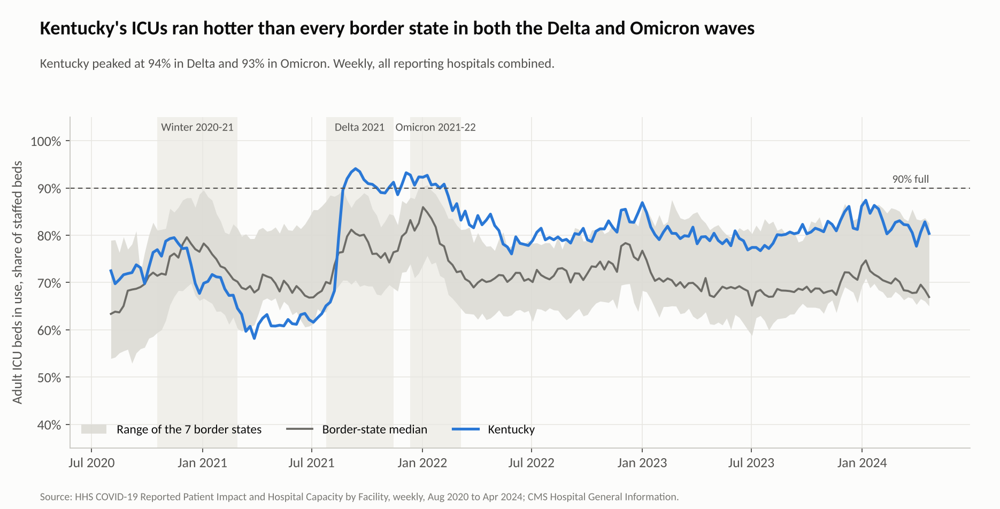
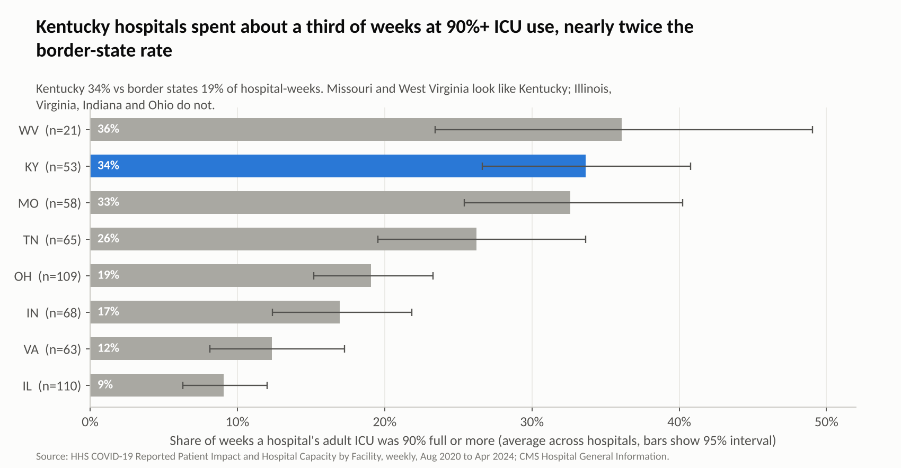
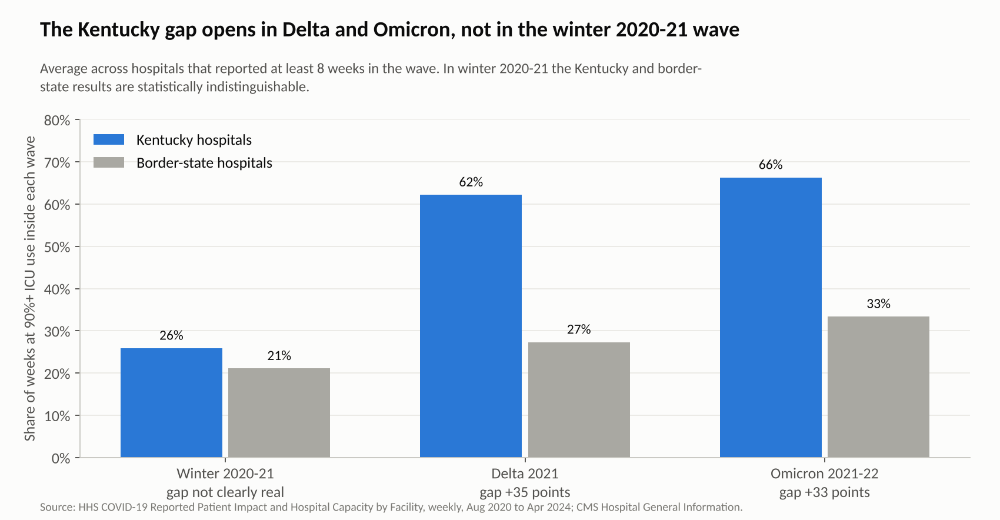
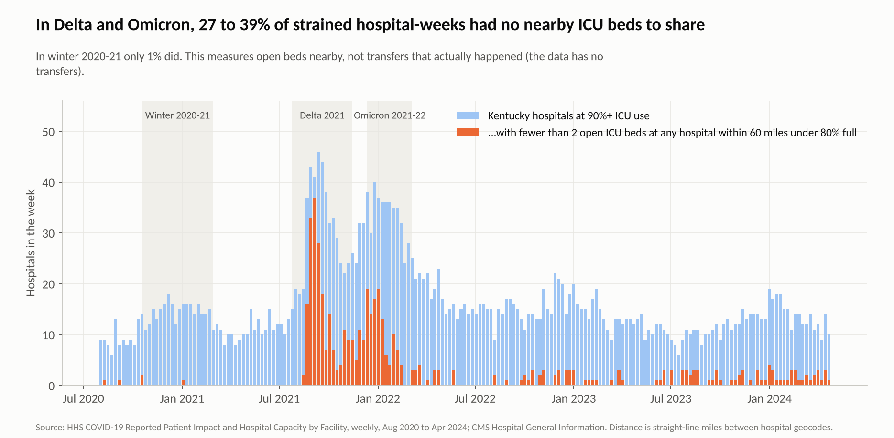
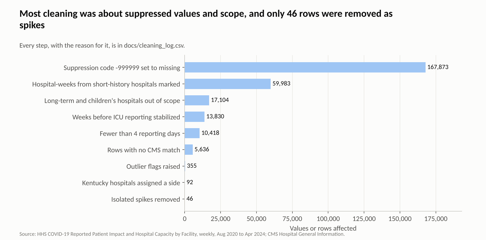

# Kentucky ICU Capacity and Strain, 2020-2024

An end-to-end analysis of hospital ICU capacity in Kentucky and its seven border states (IL, IN, MO, OH, TN, VA, WV), built on public HHS and CMS data. It asks one question a regional emergency-care coordination team would ask: **when patient volume surged, which hospitals ran out of room, and was Kentucky under more strain than the states around it?**

**Interactive dashboard:** open `dashboard/index.html` (double-click, no server needed).
**Tableau / Power BI:** flat files for building your own version are in `tableau_extracts/`.

## What I found

| Finding | Number | How sure |
|---|---|---|
| Share of weeks a typical Kentucky hospital ran ICU at 90%+ of staffed beds | 33.6% vs 18.9% for border-state hospitals | Difference 14.7 pts, 95% CI 7.6 to 22.2, permutation p < 0.001 |
| Same comparison during Delta (Jul-Nov 2021) | 62.2% vs 27.3% | Difference 34.9 pts, CI 26.4 to 42.8 |
| Same comparison during Omicron (Dec 2021-Mar 2022) | 66.3% vs 33.4% | Difference 32.9 pts, CI 21.9 to 43.4 |
| Same comparison during Winter 2020-21 | 25.9% vs 21.1% | Not distinguishable (CI -4.7 to 15.7, p = 0.27) |
| Kentucky's weekly state-level ICU peak, Delta and Omicron | 94.1% (Sep 12, 2021) and 92.7% (Dec 12, 2021) | Highest of the 8 states in both waves; ranked 6th of 8 in Winter 2020-21 |
| Kentucky hospitals at 90%+ that had no nearby hospital with room | 39% of strained hospital-weeks in Delta, 27% in Omicron | Descriptive. This measures room, not actual transfers (see limits) |
| Average ICU occupancy, Kentucky vs border states | 73.1% vs 67.8% | Not significant (CI -1.5 to 11.0, p = 0.07) |
| Lexington-side vs Louisville-side Kentucky | 35.9% vs 29.9% of weeks at 90%+ | Not significant (p = 0.44). The two sides moved together (weekly correlation 0.89), with Louisville-side peaking later in Omicron (Jan 9, 2022 vs Dec 12, 2021) |
| Critical staffing shortage, Kentucky peak | 57.5% of reporting hospitals (Sep 12, 2021) vs a median state peak of 38.4% | Descriptive |
| Staffing shortage vs ICU strain | Correlation about 0.45 at lag 0, nearly flat from -4 to +1 weeks | Does not show whether staffing leads or follows strain |
| 1-week-ahead ICU forecast | A simple model did **not** beat "next week = this week" (MAE 1.48 vs 1.40 points) | Negative result, reported as is |

Plain reading: Kentucky was not an outlier before Delta, then ran hot in both Delta and Omicron while its neighbors mostly did not. Missouri and West Virginia look much like Kentucky; Illinois, Virginia, Indiana and Ohio are the main source of the gap.

## The pictures

**Kentucky's ICU filled up faster than its neighbors during Delta and Omicron.**


**Share of weeks a typical hospital ran ICU at 90%+, by state.**


**The gap opens in Delta and Omicron, not in winter 2020-21.**


**Strained Kentucky hospitals with no nearby hospital that had room.**


**The cleaning steps, with how many values each one touched.**


More in `outputs/figures/` (Lexington-side vs Louisville-side, ICU size, staffing vs strain, forecast test).

## Honest limits

- **Data ends April 2024.** This is a look back, not a live monitor. HHS stopped requiring this reporting after that.
- **It measures staffed beds, not licensed beds.** If a hospital cut staffed beds, occupancy rises without more patients arriving. I flag one-off bed-count blips but keep sustained changes, because those are real.
- **No transfer data.** The "nearby headroom" metric (hospitals within 60 miles with ICU occupancy under 80% and at least 2 beds) shows whether room existed nearby. It does not show that anyone could or did transfer a patient.
- **The Lexington/Louisville split is my assumption.** Each Kentucky hospital is assigned to the closer of two city hubs. I could not find the official RMOCC boundary, so do not read this as RMOCC's regions.
- **Small samples.** Kentucky has 53 hospitals with stable reporting (52+ valid ICU weeks) and only 2 critical access hospitals with an ICU, so I make no critical-access claim. Dropping critical access hospitals changes nothing (see `outputs/sensitivity.csv`).
- **Waves are analyst-defined** (dates in `scripts/02_analyze.py`). The 90% line is also my choice; the 85% line gives the same conclusion.
- **Association only.** Nothing here shows why Kentucky ran hotter.

## Data (not committed, large files)

Download these three files into `data_raw/` with these exact names:

| File name | Source |
|---|---|
| `anag-cw7u.csv` | HHS, COVID-19 Reported Patient Impact and Hospital Capacity by Facility (healthdata.gov, dataset `anag-cw7u`), filtered to state in KY, IL, IN, MO, OH, TN, VA, WV |
| `g62h-syeh.csv` | HHS, COVID-19 Reported Patient Impact and Hospital Capacity by State Timeseries (healthdata.gov, dataset `g62h-syeh`) |
| `Hospital_General_Information.csv` | CMS Hospital General Information (data.cms.gov, dataset `xubh-q36u`) |

## Method

1. **Clean** (`scripts/01_clean.py`, 19 logged steps in `docs/cleaning_log.csv`). Replaced the HHS suppression code -999999 with missing (167,873 values). Kept short-term and critical access hospitals. Required 4 of 7 reporting days. Set occupancy above 150% to missing and kept 100-150% as possible surge beds. Removed 46 isolated one-week spikes that snapped back. Flagged 309 one-off bed-count blips against a local 9-week median. Started the window when ICU reporting became complete (2020-08-02). Joined CMS on the 6-digit CCN (96.6% match).
2. **Analyze** (`scripts/02_analyze.py`). Weighted state-week occupancy; hospital-level share of weeks at 90%+; bootstrap confidence intervals and permutation tests (numpy only); nearby-headroom metric; staffing lag correlation; rolling-origin forecast test; sensitivity runs for six alternative choices.
3. **Visualize** (`scripts/03_figures.py`, `scripts/04_build_dashboard.py`). Nine figures in `outputs/figures/` and a self-contained dashboard.
4. **Verify** (`scripts/05_sql_checks.py`). Loads the cleaned data into SQLite, runs the queries in `sql/`, and asserts they match the pandas results (largest gap about 0.00005). The state-level rollup from hospital data also correlates 0.975 with HHS's own state file.

## Run it

```bash
pip install -r requirements.txt
# put the three files in data_raw/ first
./run_all.sh
```

The built `dashboard/index.html` is already included. Rebuilding it needs Chart.js 4.4.1 saved as `dashboard/_chart.umd.js` (`npm pack chart.js@4.4.1`, then copy `dist/chart.umd.js`).

## Folder map

```
data_raw/          you download these (ignored by git)
data_clean/        cleaned hospital-week and state-week files
docs/              cleaning_log.csv, data_dictionary.md
scripts/           01 clean, 02 analyze, 03 figures, 04 dashboard, 05 SQL checks
sql/               three queries cross-checked against pandas
outputs/           result tables, headline_facts.json, figures/
tableau_extracts/  flat files for Tableau or Power BI
dashboard/         index.html
```

## Skills shown

SQL and pandas cross-validation, data cleaning with a documented decision log, outlier handling, confidence intervals and permutation tests, sensitivity analysis, time-series evaluation against a naive baseline, geographic analysis, dashboard design, and plain reporting of limits and a negative result.

Data: HHS and CMS public data. Not affiliated with the University of Kentucky or any health system.
